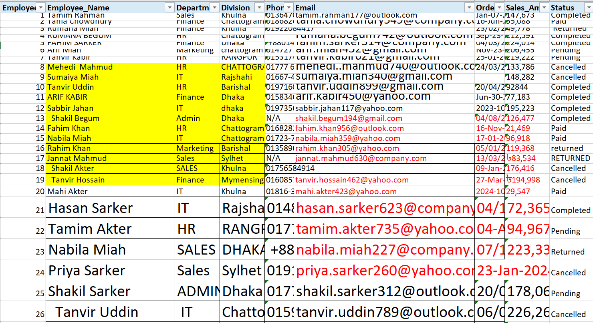
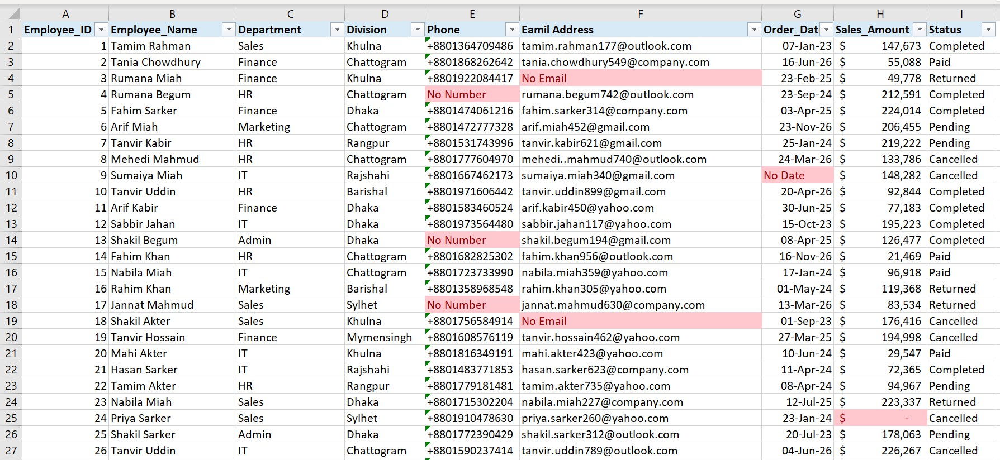

# Excel-Data-Cleaning-Project
A practical Excel data cleaning project demonstrating data quality improvement and data preparation skills.

# Project Overview

This project demonstrates a practical data cleaning workflow using Microsoft Excel. The objective is to improve data quality, consistency, and reliability before performing further analysis.

# Objectives
1.Identified and removed duplicate records
2.Handled missing and inconsistent values
3.Standardized text formats and capitalization
4.Cleaned and validated date fields
5.Corrected formatting inconsistencies
6.Identified invalid and inconsistent data entries
7.Used Excel formulas and data-cleaning techniques to improve data quality
8.Prepared the final dataset for analysis and reporting

# Tools Used
1.Microsoft Excel
2.Excel Formulas
3.Data Validation
4.Find & Replace
5.Text to Columns
6.Conditional Formatting

# Project Files
Messy_Raw_Data.xlsx — Original dataset before cleaning.
Clean_Data.xlsx — Final cleaned dataset.
Data Cleaning.pdf — Summary of data quality issues and cleaning results.
images/ — Before-and-after screenshots.

## Before Data Cleaning

)

## After Data Cleaning

# Data Cleaning Process
Inspected the original dataset.
Identified data quality issues.
Standardized inconsistent values and formats.
Handled missing and duplicate records based on the project requirements.
Validated the cleaned dataset.
Reviewed the final output.

## Skills Demonstrated
Microsoft Excel | Data Cleaning | Data Quality | Data Validation | Data Preparation

# Author

